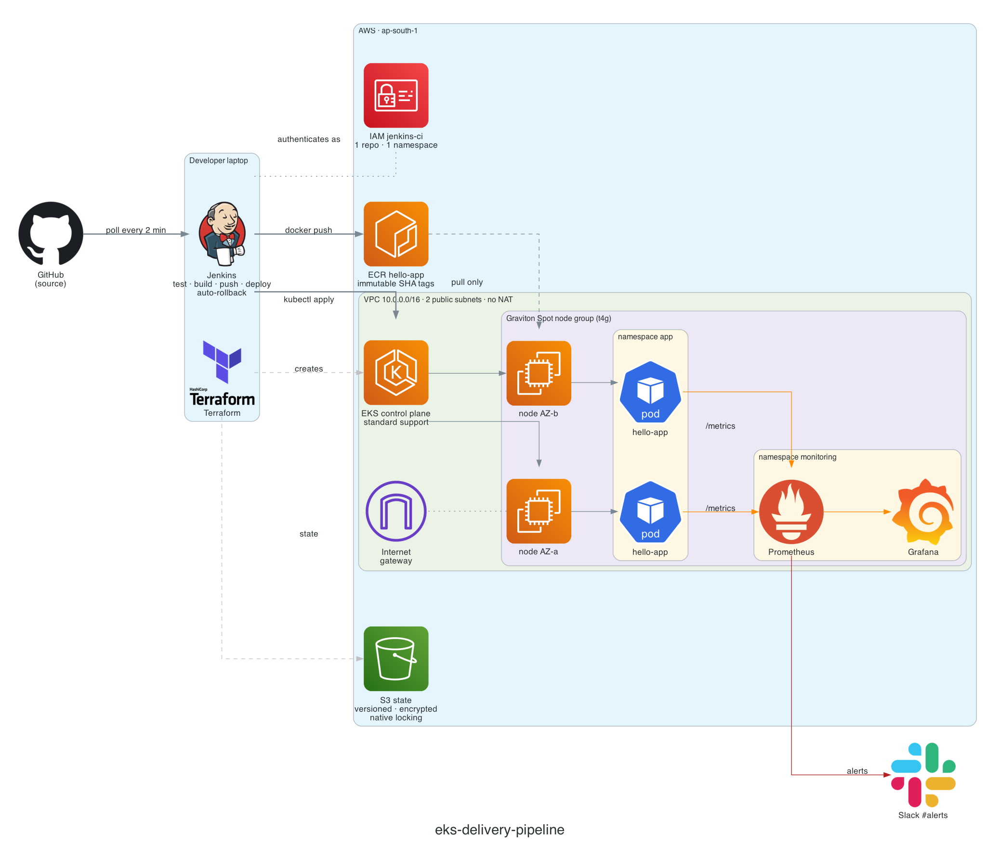

<div align="center">

# Cloud-Native Delivery Pipeline on AWS EKS

**Commit → tested → containerized → deployed to Kubernetes on AWS, with zero-downtime rollouts,
automatic rollback and symptom-based alerting.**

[](https://github.com/naitikjasani/eks-delivery-pipeline/actions/workflows/checks.yml)


[](LICENSE)


<sub>Every pod is replaced while ~5 requests/second flow through the Service, and every request returns HTTP 200
(<code>make demo ACT=rollout</code>).</sub>

</div>

| ≈ $0.14 / hour | 0 failed requests | ≤ 120 s | 64.7 MB | 100% |
|:---:|:---:|:---:|:---:|:---:|
| running cost on AWS | during a full rollout | to detect a bad release and roll back | arm64 runtime image, non-root | infrastructure as code |

---

## Contents
[Architecture](#architecture) · [Highlights](#highlights) · [See it work](#see-it-work) · [Verified](#verified) ·
[Engineering decisions](#engineering-decisions) · [Cost](#cost) · [Quick start](#quick-start) · [Repository layout](#repository-layout)

## Architecture



**The flow:** a `git push` is picked up by Jenkins → tests run inside Docker → the image is tagged with the commit SHA
and pushed to an immutable ECR repository → Kubernetes performs a rolling update on EKS → if the new pods aren't Ready
within 120 s, Jenkins runs `kubectl rollout undo` and fails the build. Prometheus scrapes the app, Grafana shows the
golden signals, and Alertmanager posts to Slack when users would notice a problem.

➡️ Detailed diagrams (pipeline, rolling-update sequence, network and IAM, monitoring flow) in
**[docs/ARCHITECTURE.md](docs/ARCHITECTURE.md)**.

## Highlights

| | What | How (click through to the code) |
|---|---|---|
| 🏗️ | **Infrastructure as code** | Modular Terraform ([`network`](infra/modules/network/), [`eks`](infra/modules/eks/), [`ecr`](infra/modules/ecr/), [`ci-access`](infra/modules/ci-access/)), remote state in S3 with native locking, plain resources (no community modules) so every billable thing is visible |
| 🔁 | **Zero-downtime deploys** | `maxUnavailable: 0`, readiness probes, a `preStop` delay ([`deployment.yaml`](k8s/deployment.yaml)) and graceful SIGTERM handling ([`server.js`](app/src/server.js)) |
| ⏪ | **Automatic rollback** | `kubectl rollout status --timeout=120s` → `rollout undo` in the [`Jenkinsfile`](Jenkinsfile) |
| 🏷️ | **Traceable, immutable artifacts** | Image tag = git SHA; ECR tags can't be overwritten; re-runs skip existing tags |
| 🔐 | **Least privilege** | Jenkins can push to **one** ECR repo and edit **one** namespace (EKS access entries, no `aws-auth`); nodes can only *pull*; containers run non-root with a read-only filesystem and no capabilities |
| 📈 | **Observability** | Prometheus metrics with bounded label cardinality ([`metrics.js`](app/src/metrics.js)), a golden-signals Grafana dashboard, and 4 symptom-based [alerts](monitoring/prometheusrule.yaml) routed to Slack |
| 💸 | **Cost-engineered** | Graviton Spot nodes, no NAT gateway, no load balancer, no CloudWatch/KMS extras, cluster pinned to standard support, Jenkins on a laptop |
| ✅ | **Checked on every push** | [GitHub Actions](.github/workflows/checks.yml): tests in Node and Docker, `terraform fmt`/`validate`, a forbidden-resource cost guard, shellcheck, hadolint, kubeconform, secret scan |

## See it work

Everything below runs on a **free local kind cluster** with one command: `make demo`
([how to run it yourself](docs/DEMO.md)).

<table>
<tr>
<td width="50%"><b>Broken release → automatic rollback</b><br>
A release that passes its tests but crashes on startup. The old pods keep serving, the rollout times out,
and it's rolled back with traffic still at 100% HTTP 200.<br><br>
</td>
<td width="50%"><b>Alerting on user-facing errors</b><br>
~30% error traffic drives <code>HelloAppHighErrorRate</code> from inactive → pending → <b>firing</b>;
Alertmanager routes it to Slack.<br><br>
</td>
</tr>
</table>

| # | Demo | What it proves |
|---|---|---|
| 1 | First deploy: commit → running pods | End-to-end CI/CD into EKS via ECR |
| 2 | Change the code while traffic flows through the Service | Zero-downtime rolling update |
| 3 | Release that passes tests but crashes at startup | Automatic rollback; old pods kept serving |
| 4 | Generate 5xx traffic | Grafana shows the spike; Slack gets FIRING, then RESOLVED |
| 5 | Use Jenkins' credentials against S3 / the monitoring namespace | Least privilege: AccessDenied / Forbidden |

The environment is torn down between sessions to avoid cloud costs; `terraform apply` recreates it in ~15 minutes.

## Verified

| Check | How | Result |
|---|---|---|
| Unit tests | `npm test` locally and inside `docker build --target test` | 6/6 pass |
| Zero downtime | Continuous in-cluster traffic during `kubectl rollout restart` | **221/221** requests HTTP 200; served by old and new pods |
| Broken release contained | Crashing release deployed under traffic | New pod `CrashLoopBackOff`, old pods kept serving, rolled back |
| Alerting | ~30% error traffic | `HelloAppHighErrorRate` FIRING at 30.3%, received by Alertmanager |
| Graceful shutdown | `docker stop` on the running container | Exits in 0.2 s (SIGTERM handled, not killed) |
| Image | `docker image inspect` | arm64, 64.7 MB, runs as uid 1000 |
| Pipeline | Jenkins build with `DEPLOY_ENABLED=false`; the Test/Build stage commands re-run with a deliberately broken test | Checkout, Preflight, Test, Build green; the broken test fails at Test and Build never runs |
| Infrastructure code | `terraform fmt -check`, `validate`, forbidden-resource grep | Clean, also enforced in CI |

## Engineering decisions

Every trade-off is written down as a short decision record: context, decision, consequences, and what production
would do instead.

| ADR | Decision |
|---|---|
| [0001](docs/adr/0001-public-subnets-no-nat.md) | Nodes in public subnets, no NAT gateway |
| [0002](docs/adr/0002-graviton-spot-nodes.md) | Graviton (ARM) Spot instances |
| [0003](docs/adr/0003-local-jenkins-scoped-key.md) | Local Jenkins with a namespace-scoped IAM key |
| [0004](docs/adr/0004-immutable-sha-image-tags.md) | Immutable git-SHA image tags |
| [0005](docs/adr/0005-s3-native-state-locking.md) | S3-native state locking, no DynamoDB |
| [0006](docs/adr/0006-push-based-deploys.md) | Push-based deploys instead of GitOps |
| [0007](docs/adr/0007-plain-yaml-over-helm.md) | Plain YAML instead of a Helm chart |
| [0008](docs/adr/0008-grafana-memory-limit.md) | Grafana memory limit raised after measuring an OOM loop |

## Cost

| While the EKS cluster exists | Per hour |
|---|---|
| EKS control plane | $0.10 |
| 2 × t4g.medium Spot nodes | ~$0.02 |
| 2 public IPv4 addresses + 40 GB of node disk | ~$0.015 |
| S3 state, ECR images | ~$0.00 |
| **Total** | **≈ $0.14/hour (≈ ₹12)**, and $0 after `terraform destroy` |

The full demo (build, record, destroy) needs about 3 cluster-hours. Prices are approximate (ap-south-1); check the AWS pricing pages.

| Production would use… | Here instead, to save cost |
|---|---|
| Private subnets + NAT gateway | Public subnets, cluster-only security group |
| Load balancer + domain + TLS | `kubectl port-forward` |
| Jenkins on AWS with an IAM role / OIDC | Local Jenkins with a least-privilege key deleted on destroy |
| On-demand + Spot mix, PodDisruptionBudgets | Spot only |
| Persistent Prometheus storage | 6 h retention in memory |

## Quick start

> Full, beginner-level instructions: **[docs/RUNBOOK.md](docs/RUNBOOK.md)**. Run `make` to list all shortcuts.

<details open>
<summary><b>Free, local (kind)</b></summary>

```bash
make test                      # unit tests, locally and inside Docker
make kind-up deploy            # local cluster + app
make monitoring                # Prometheus, Grafana, Alertmanager, alerts, dashboard
make demo                      # guided demo: rollout, rollback, alert
kubectl -n app port-forward svc/hello-app 8081:80     # http://localhost:8081
```
</details>

<details>
<summary><b>AWS (paid while running)</b></summary>

```bash
terraform -chdir=infra/bootstrap init && terraform -chdir=infra/bootstrap apply
cp infra/envs/dev/backend.hcl.example infra/envs/dev/backend.hcl            # fill in the bucket name
cp infra/envs/dev/terraform.tfvars.example infra/envs/dev/terraform.tfvars  # fill in the values
terraform -chdir=infra/envs/dev init -backend-config=backend.hcl
terraform -chdir=infra/envs/dev plan
terraform -chdir=infra/envs/dev apply
aws eks update-kubeconfig --region ap-south-1 --name eks-pipeline-dev
```
</details>

<details>
<summary><b>Teardown (always)</b></summary>

```bash
helm -n monitoring uninstall monitoring; kubectl delete namespace monitoring app
terraform -chdir=infra/envs/dev destroy
./scripts/teardown-check.sh        # must print ALL CLEAR
```
</details>

## Repository layout

| Path | What's inside |
|---|---|
| `app/` | Node.js service with `/`, `/health/live`, `/health/ready`, `/metrics`, `/error`, `/slow` + tests + multi-stage Dockerfile |
| `k8s/` | Deployment and Service manifests |
| `monitoring/` | kube-prometheus-stack values, ServiceMonitor, alert rules, Grafana dashboard |
| `jenkins/` | Local Jenkins image (docker CLI, AWS CLI, kubectl) + compose file |
| `Jenkinsfile` | The pipeline: Preflight → Test → Build → Push → Deploy (+ auto rollback) |
| `infra/bootstrap/` | S3 bucket for Terraform state |
| `infra/modules/` | `network`, `eks`, `ecr`, `ci-access` |
| `infra/envs/dev/` | The environment that wires the modules together |
| `kind/`, `scripts/` | Free local cluster, deploy helpers, traffic generator, guided demo, teardown checker |
| `.github/workflows/` | Checks-only CI (tests, lint, Terraform validation); Jenkins does the build and deploy |
| `docs/` | Architecture, decision records, demo guide, runbook, beginner guide, interview prep |

## Pinned versions

| Component | Version |
|---|---|
| Terraform | ≥ 1.10 (built and validated with 1.17.2) |
| AWS provider | ~> 6.0 (locked to 6.73.0 in `.terraform.lock.hcl`) |
| Kubernetes (EKS) | 1.37: newest standard-support version in November 2026 (standard support until Dec 1, 2027). Re-check with `aws eks describe-cluster-versions` before `apply` |
| kube-prometheus-stack | 93.3.0 (see [`monitoring/README.md`](monitoring/README.md)) |
| Node.js | 24 LTS (`node:24-alpine`) |
| Express / prom-client | 5.x / 15.x |
| Jenkins | `jenkins/jenkins:lts-jdk21` |

## Learn more
- [docs/ARCHITECTURE.md](docs/ARCHITECTURE.md): diagrams of every flow, with the file that implements each piece
- [docs/adr/](docs/adr/README.md): the decision records
- [docs/DEMO.md](docs/DEMO.md): run the guided demo yourself in about 10 minutes
- [docs/BEGINNER_GUIDE.md](docs/BEGINNER_GUIDE.md): every tool and concept in plain words
- [docs/RUNBOOK.md](docs/RUNBOOK.md): step-by-step setup, demos, teardown, troubleshooting
- [docs/INTERVIEW_PREP.md](docs/INTERVIEW_PREP.md): questions this project answers
- [PROJECT.md](PROJECT.md): the full build specification

<div align="center"><sub>MIT licensed · built by <a href="https://github.com/naitikjasani">Naitik Jasani</a></sub></div>
