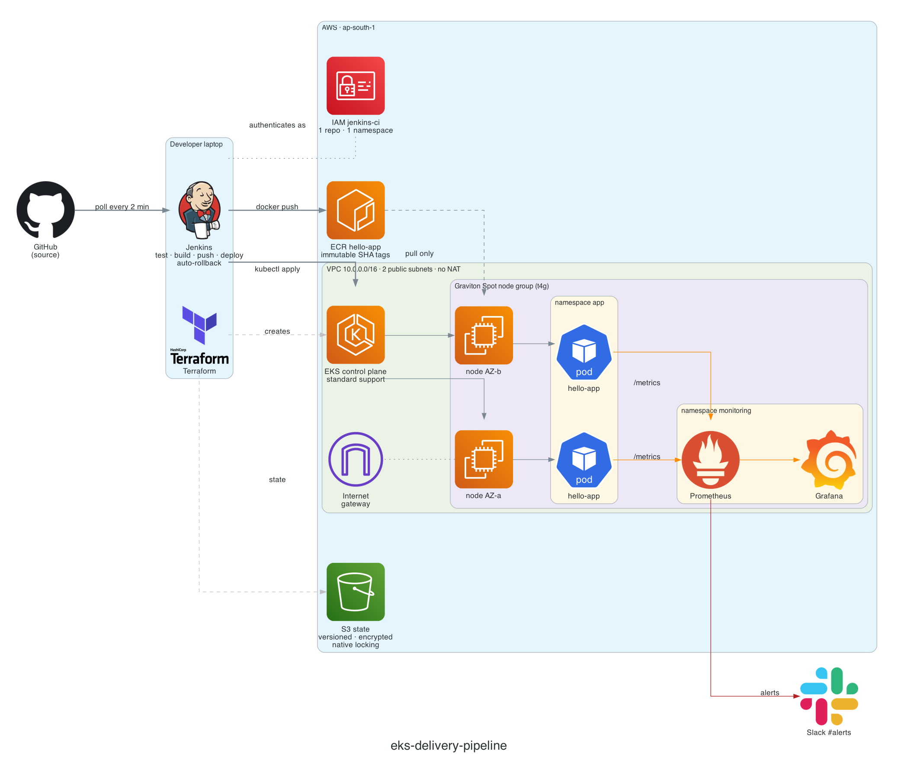
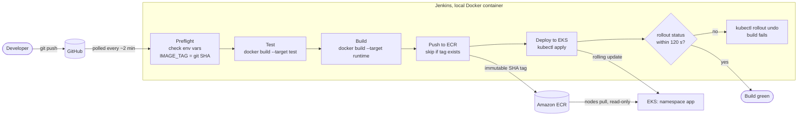
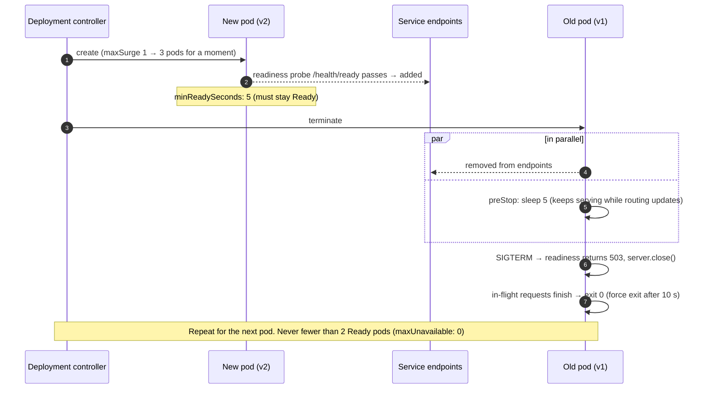
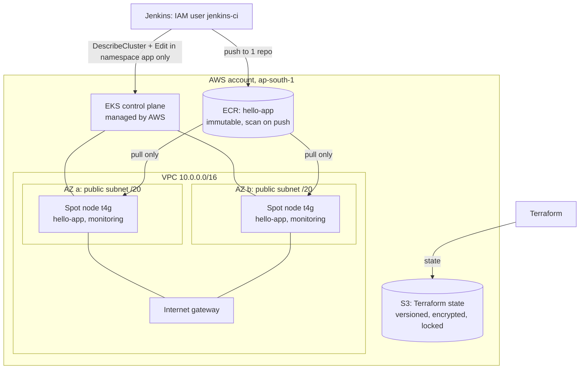
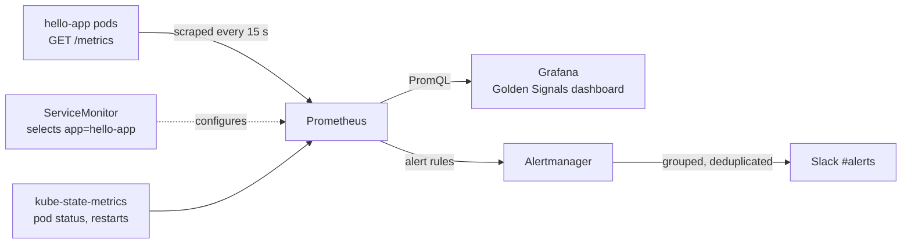

# Architecture

How the pieces fit together, from a `git push` to a running, monitored pod on AWS EKS.
Each diagram is followed by the files that implement it. The *why* behind each choice is in the
[decision records](adr/README.md).

---

## 1. Delivery pipeline

- A failing test stops the pipeline at **Test**, so nothing is pushed.
- The image tag is the commit SHA, and ECR tags are immutable, so every running pod traces back to one commit.
- If the new pods never become Ready, Jenkins rolls back and fails the build. The old pods were never removed
  (`maxUnavailable: 0`), so users never see an outage.

| Piece | File |
|---|---|
| Pipeline stages, rollback logic, credentials handling | [`Jenkinsfile`](../Jenkinsfile) |
| Test / runtime image stages | [`app/Dockerfile`](../app/Dockerfile) |
| Jenkins image (docker CLI, AWS CLI, kubectl, plugins) | [`jenkins/`](../jenkins/) |
| Public checks on every push (tests, lint, `terraform validate`) | [`.github/workflows/checks.yml`](../.github/workflows/checks.yml) |

## 2. Zero-downtime rolling update

What happens to traffic when a new version replaces an old pod:

Four pieces work together. Remove any one and requests can fail during a deploy:

| Piece | Where | Protects against |
|---|---|---|
| `maxUnavailable: 0`, `maxSurge: 1` | [`k8s/deployment.yaml`](../k8s/deployment.yaml) | Removing an old pod before its replacement is Ready |
| Readiness probe (`/health/ready`) | `k8s/deployment.yaml`, [`app/src/app.js`](../app/src/app.js) | Sending traffic to a pod that isn't ready yet, or is shutting down |
| `preStop: sleep 5` | `k8s/deployment.yaml` | Routing a request to a pod after it has stopped, while endpoint removal spreads through the cluster |
| Graceful SIGTERM handling | [`app/src/server.js`](../app/src/server.js) | Cutting off in-flight requests when the process stops |

Measured on kind: **221 of 221 requests returned HTTP 200** during a `rollout restart` under continuous traffic.

## 3. AWS infrastructure and access

| Identity | Can do | Defined in |
|---|---|---|
| Cluster role | Lets EKS manage AWS resources for the control plane | [`infra/modules/eks/main.tf`](../infra/modules/eks/main.tf) |
| Node role | Join the cluster, run the VPC CNI, **pull** images (no push) | `infra/modules/eks/main.tf` |
| `jenkins-ci` user | Push to the `hello-app` repo, describe one cluster, edit only namespace `app` | [`infra/modules/ci-access/main.tf`](../infra/modules/ci-access/main.tf) |

- No NAT gateway and no load balancer (see [ADR 0001](adr/0001-public-subnets-no-nat.md)). The app is reached with `kubectl port-forward`.
- Graviton Spot nodes ([ADR 0002](adr/0002-graviton-spot-nodes.md)); the cluster is pinned to standard support pricing.
- Modules: [`network`](../infra/modules/network/) → [`eks`](../infra/modules/eks/) → [`ecr`](../infra/modules/ecr/) →
  [`ci-access`](../infra/modules/ci-access/), wired together in [`infra/envs/dev`](../infra/envs/dev/).
  The state bucket comes from [`infra/bootstrap`](../infra/bootstrap/).

## 4. Monitoring and alerting

| Alert | Fires when | For |
|---|---|---|
| `HelloAppDown` | No hello-app target can be scraped | 1 m |
| `HelloAppHighErrorRate` | More than 5% of requests return 5xx | 1 m |
| `HelloAppHighLatencyP95` | p95 latency above 500 ms | 5 m |
| `HelloAppPodRestarting` | More than 2 restarts in 10 minutes | immediately |

The dashboard covers the four golden signals: traffic, errors, latency (p50/p95/p99) and saturation (CPU and memory per pod).

| Piece | File |
|---|---|
| Request counter + latency histogram (route-pattern labels, bounded cardinality) | [`app/src/metrics.js`](../app/src/metrics.js) |
| Chart settings (no disks, small requests, EKS-hidden components off) | [`monitoring/values.yaml`](../monitoring/values.yaml) |
| Scrape target | [`monitoring/servicemonitor.yaml`](../monitoring/servicemonitor.yaml) |
| Alert rules | [`monitoring/prometheusrule.yaml`](../monitoring/prometheusrule.yaml) |
| Dashboard (ConfigMap, loaded by the Grafana sidecar) | [`monitoring/grafana-dashboard.yaml`](../monitoring/grafana-dashboard.yaml) |
| Slack routing template | [`monitoring/alertmanager-slack.values.example.yaml`](../monitoring/alertmanager-slack.values.example.yaml) |

## 5. Local and cloud: the same manifests

| | Local (free) | AWS (paid while running) |
|---|---|---|
| Cluster | kind `devops-lab` (1 control plane + 1 worker) | EKS `eks-pipeline-dev` (2 Spot nodes) |
| Image source | `kind load docker-image hello-app:local` | ECR `hello-app:<git-sha>` |
| Deploy | [`scripts/kind-deploy.sh`](../scripts/kind-deploy.sh) | Jenkins "Deploy to EKS" stage |
| Monitoring values | `values.yaml` + `values-kind.yaml` | `values.yaml` |
| Manifests | `k8s/` (`IMAGE_PLACEHOLDER` replaced by `sed`) | the same `k8s/` |
